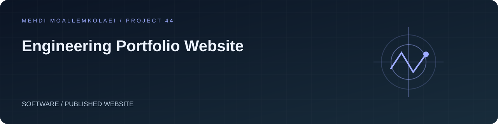
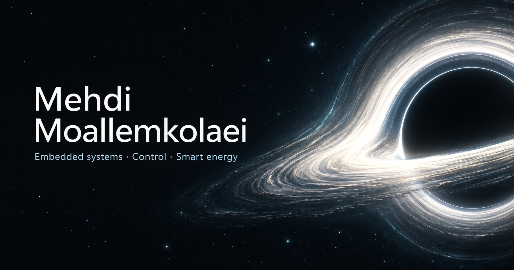

# Engineering Portfolio Website

**Present engineering work through project pages and an experimental 3D space-themed interface.**

Web · Portfolio · 3D · GitHub Pages

[Overview](#overview) · [Design](portfolio/DESIGN.md) · [Setup](portfolio/SETUP.md) · [Validation](portfolio/VALIDATION.md) · [Evidence](portfolio/EVIDENCE.md)

## Overview

| Item | Record |
| :-- | :-- |
| Project type | Published website |
| Field | Software |
| Material in this package | Existing repository inspected |
| Documentation review | 17 November 2026 |

## Scope

Present engineering work through project pages and an experimental 3D space-themed interface. The documentation separates the stated project scope, inspected artifacts and future work. A listed feature is not a new test result.

### Main elements

- Project records
- Navigation
- Project views
- Visual assets
- Published site

## Start here

1. Read the [design record](portfolio/DESIGN.md) for the system elements and boundaries.
2. Follow the [setup record](portfolio/SETUP.md) for available entry points.
3. Use the [validation plan](portfolio/VALIDATION.md) to record reproducible results.
4. Check the [evidence register](portfolio/EVIDENCE.md) before reusing claims.

## Technical limits

The inspected repository contains a published web build, JavaScript bundles and route files. A complete editable development source tree and its build procedure were not established. Repository documentation changes do not change the deployed application.

## Project preview

This image is an existing repository artifact. It is not evidence of a new test.

## Available material

| Path | Type |
| :-- | :-- |
| [.assetsignore](https://github.com/Ace-Alch/Ace-Alch.github.io/blob/main/.assetsignore) | file |
| [.github/pages-files.json](https://github.com/Ace-Alch/Ace-Alch.github.io/blob/main/.github/pages-files.json) | .json |
| [.github/scripts/stage-pages.py](https://github.com/Ace-Alch/Ace-Alch.github.io/blob/main/.github/scripts/stage-pages.py) | .py |
| [.github/workflows/deploy-pages.yml](https://github.com/Ace-Alch/Ace-Alch.github.io/blob/main/.github/workflows/deploy-pages.yml) | .yml |
| [.nojekyll](https://github.com/Ace-Alch/Ace-Alch.github.io/blob/main/.nojekyll) | file |
| [.vite/manifest.json](https://github.com/Ace-Alch/Ace-Alch.github.io/blob/main/.vite/manifest.json) | .json |
| [404.html](https://github.com/Ace-Alch/Ace-Alch.github.io/blob/main/404.html) | .html |
| [UPLOAD-INSTRUCTIONS.txt](https://github.com/Ace-Alch/Ace-Alch.github.io/blob/main/UPLOAD-INSTRUCTIONS.txt) | .txt |
| [_headers](https://github.com/Ace-Alch/Ace-Alch.github.io/blob/main/_headers) | file |
| [apps/circuit-lab.rsc](https://github.com/Ace-Alch/Ace-Alch.github.io/blob/main/apps/circuit-lab.rsc) | .rsc |
| [apps/circuit-lab/index.html](https://github.com/Ace-Alch/Ace-Alch.github.io/blob/main/apps/circuit-lab/index.html) | .html |
| [apps/inertia-lab/index.html](https://github.com/Ace-Alch/Ace-Alch.github.io/blob/main/apps/inertia-lab/index.html) | .html |

See the [complete source inventory](portfolio/SOURCE-INVENTORY.md) for all inspected file paths.

## Next work

- [ ] Editable source location
- [ ] Build provenance
- [ ] Performance and accessibility tests

## Credits and reuse

Project record: Mehdi Moallemkolaei. Specific third-party and course contributions must retain their original notices.

Existing license terms remain in effect. This package does not grant a new license over source code, course material, models or datasets. See [reuse and contribution notes](portfolio/CONTRIBUTIONS.md).
